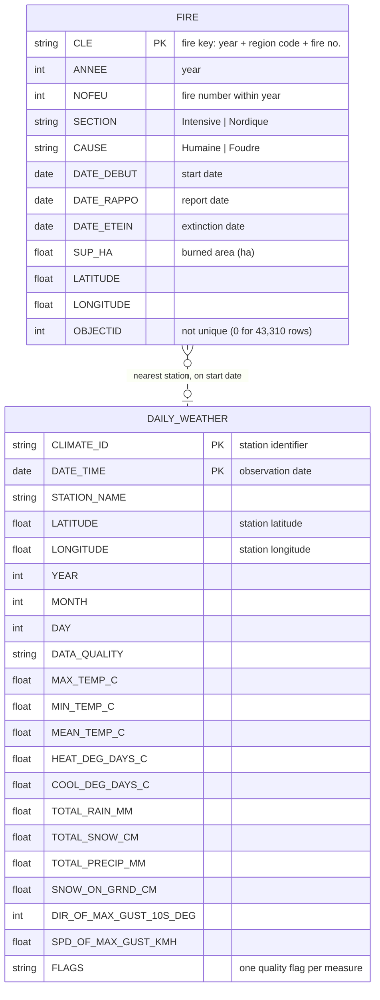

# Phase 1 — B. Summary of the Collected Datasets

## B.1 Data Sources

The project integrates two independently published open-government datasets from two different agencies, in two different formats.

| | Dataset 1 — Wildfire origin points | Dataset 2 — Historical daily weather |
|---|---|---|
| **Publisher** | SOPFEU / Ministère des Ressources naturelles et des Forêts (MRNF), Québec | Environment and Climate Change Canada (ECCC) |
| **Portal** | Données Québec (donneesquebec.ca) — *Feux de forêt, points d'origine* | Historical Climate Data (climate.weather.gc.ca) |
| **Licence** | CC-BY | Open Government Licence – Canada |
| **Format** | ESRI Shapefile (zipped), point geometry | CSV, one file per station per year |
| **Collection method** | Manual download of `Feux_pt_ori_SHP.zip` | Scripted bulk download (78 HTTP requests) |
| **Coverage** | Every fire in Québec's protection zones, 1972–2024 | 3 stations, every day from 2000-01-01 to 2025-12-31 |
| **Spatial reference** | NAD83 geographic coordinates (degrees), from the `.prj` file | Station latitude/longitude in decimal degrees |

**Weather download.** Each file was retrieved from the ECCC bulk-data endpoint:

```
https://climate.weather.gc.ca/climate_data/bulk_data_e.html?format=csv&stationID=<STATION_ID>&Year=<YEAR>&Month=1&Day=1&timeframe=2
```

`timeframe=2` selects daily data. The endpoint takes ECCC's internal *Station ID*. The publicly listed *Climate ID* was mapped to it using ECCC's Station Inventory file. The three stations were chosen because they are closest to the three regions where fires are most concentrated:

| Station | Climate ID | Station ID | Latitude | Longitude | Region represented |
|---|---|---|---|---|---|
| Sorel | 7028200 | 5532 | 46.03 | −73.12 | Southern band (Montérégie / Mauricie / Lanaudière) |
| Lac Bouchette | 7063560 | 5913 | 48.22 | −72.17 | Central boreal (Saguenay–Lac-Saint-Jean / Abitibi) |
| Les Buissons | 7044288 | 5701 | 49.12 | −68.38 | Northern coast (Côte-Nord) |

**Storage.** Both raw zip archives were uploaded to the Unity Catalog volume `wildfire_project.bronze.raw_files` in Databricks and loaded, unmodified, into two Bronze Delta tables.

## B.2 Entity–Relationship Diagram



The diagram has one entity per collected dataset. The dashed line marks a relationship that is not stored in either dataset: the two sources share no common key, so the project creates the link during integration (Section C).

| Relationship | Cardinality | How it is established |
|---|---|---|
| FIRE *occurs near / on the date of* DAILY_WEATHER | N : 0..1 | Each fire is first assigned the weather station closest to its origin point (haversine distance between the fire's `LATITUDE`/`LONGITUDE` and each station's coordinates). The fire is then matched to that station's row for the fire's start date: (`nearest CLIMATE_ID`, `DATE_DEBUT`) = (`CLIMATE_ID`, `DATE_TIME`). A fire matches at most one weather row, and none if that day is missing. A weather row can match many fires, or none. |

**Example.** Fire `20221080001` started on 2022-04-06 at 45.1289 N, 72.1135 W. Its distances to the three stations are 127 km (Sorel), 344 km (Lac Bouchette) and 526 km (Les Buissons), so it is matched to Sorel's record for 2022-04-06: max 11.5 °C, min −0.5 °C, 2.2 mm of precipitation.

**Notes on the entities**

- **FIRE primary key.** `CLE` is unique across all 44,471 records, and so is the pair (`ANNEE`, `NOFEU`). `OBJECTID`, despite its name, is not an identifier: 43,310 rows have the value 0.
- **DAILY_WEATHER primary key.** The composite key is (`CLIMATE_ID`, `DATE_TIME`). It is unique across all 28,491 rows.
- **Station attributes.** `STATION_NAME`, `LATITUDE` and `LONGITUDE` are repeated on every row of a station (9,497 times each), because they depend on `CLIMATE_ID` alone, not on the date. This redundancy is examined as a functional dependency in Section C.
- **Flag columns.** Every measurement in the weather files has a companion flag column, for example `Max Temp Flag` (M = missing, E = estimated, T = trace). These are shown as one `FLAGS` attribute to keep the diagram readable.

## B.3 Statistics

### Overall

| Metric | Wildfire dataset | Weather dataset | Total |
|---|---|---|---|
| Downloaded archives | 1 zip (2.19 MB) | 1 zip (0.45 MB)¹ | 2 zips, 2.64 MB |
| Files after extraction | 8 (one Shapefile set) | 78 CSV (3 stations × 26 years) | **86 files** |
| Size after extraction | 40.94 MB | 4.64 MB | **45.57 MB** |
| Logical tables | 1 (attribute table + point geometry) | 1 (78 files share an identical schema) | **2** |
| Source columns | 12 attributes + 1 geometry = **13** | **31** (20 descriptors/dates/measures + 11 flags) | **44** |
| Rows | **44,471** fires (1972–2024) | **28,491** station-days | **72,962** |
| Rows in project scope | 15,078 fires (2000–2024) | 28,491 (2000–2025) | 43,569 |
| Bronze Delta table | `bronze.fires_raw` — 15 columns², 1.10 MB | `bronze.weather_daily_raw` — 33 columns², 0.22 MB | 2 tables, 1.33 MB |

MB = 10⁶ bytes.
¹ The weather zip was created by the team to upload the 78 files in one step.
² Bronze adds two audit columns, `_source_file` and `_ingested_at`. Delta sizes are smaller than the raw sizes because Delta stores data as compressed Parquet.

### Wildfire Shapefile components

| File | Purpose | Size |
|---|---|---|
| `FEUX_PT_ORI_1972_2024.dbf` | Attribute table (the 12 columns) | 38.87 MB |
| `FEUX_PT_ORI_1972_2024.shp` | Point geometry | 1.25 MB |
| `FEUX_PT_ORI_1972_2024.sbn` / `.sbx` | Spatial index (ESRI) | 0.46 MB |
| `FEUX_PT_ORI_1972_2024.shx` | Geometry-to-record index | 0.36 MB |
| `FEUX_PT_ORI_1972_2024.shp.xml` | Metadata | 0.01 MB |
| `FEUX_PT_ORI_1972_2024.prj` | Coordinate reference system | < 0.01 MB |
| `FEUX_PT_ORI_1972_2024.cpg` | Text encoding of the `.dbf` | < 0.01 MB |

### Wildfire records by cause and protection zone

| | Intensive | Nordique | Total |
|---|---|---|---|
| **All years (1972–2024)** | | | |
| Humaine (human) | 31,204 | 733 | 31,937 |
| Foudre (lightning) | 10,075 | 2,459 | 12,534 |
| Total | 41,279 | 3,192 | 44,471 |
| **Project scope (2000–2024)** | | | |
| Humaine (human) | 9,846 | 257 | 10,103 (67%) |
| Foudre (lightning) | 3,819 | 1,156 | 4,975 (33%) |
| Total | 13,665 | 1,413 | 15,078 |

### Weather records by station

| Station | Files | Days | First day | Last day |
|---|---|---|---|---|
| Sorel | 26 | 9,497 | 2000-01-01 | 2025-12-31 |
| Lac Bouchette | 26 | 9,497 | 2000-01-01 | 2025-12-31 |
| Les Buissons | 26 | 9,497 | 2000-01-01 | 2025-12-31 |
| **Total** | **78** | **28,491** | | |

### Column inventory

**Wildfire attribute table (12 columns + geometry)**

| Column | Meaning | Example |
|---|---|---|
| `OBJECTID` | GIS object number (not unique) | 1 |
| `CLE` | Unique fire key | 20221080001 |
| `ANNEE` | Year | 2022 |
| `NOFEU` | Fire number within the year | 1 |
| `SECTION` | Protection zone | Intensive |
| `CAUSE` | Cause of ignition | Humaine |
| `DATE_DEBUT` | Start date | 20220406 |
| `DATE_RAPPO` | Report date | 20220406 |
| `DATE_ETEIN` | Extinction date | 20220406 |
| `SUP_HA` | Burned area (hectares) | 0.4 |
| `LATITUDE` | Origin latitude (NAD83) | 45.1289 |
| `LONGITUDE` | Origin longitude (NAD83) | −72.1135 |
| *geometry* | Point origin, `POINT (longitude latitude)` | POINT (−72.1135 45.1289) |

**Weather CSV (31 columns)**

| Group | Columns |
|---|---|
| Station descriptors (5) | Longitude (x), Latitude (y), Station Name, Climate ID, Data Quality |
| Date (4) | Date/Time, Year, Month, Day |
| Measures (11), each with a flag column (11) | Max Temp (°C), Min Temp (°C), Mean Temp (°C), Heat Deg Days (°C), Cool Deg Days (°C), Total Rain (mm), Total Snow (cm), Total Precip (mm), Snow on Grnd (cm), Dir of Max Gust (10s deg), Spd of Max Gust (km/h) |
