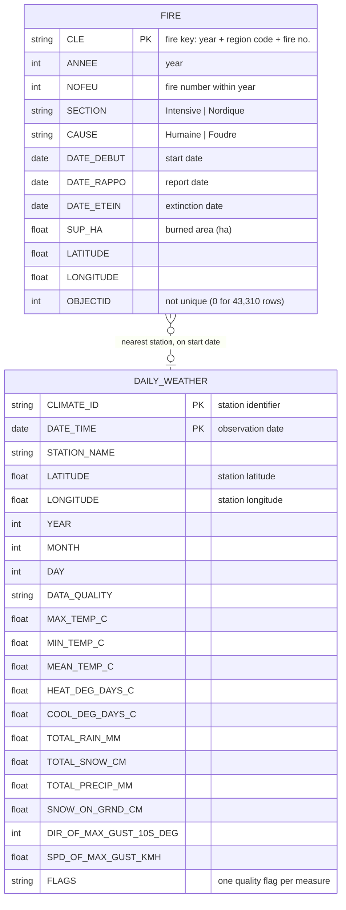

# Phase 1 — B. Summary of the Collected Datasets

## B.1 Data Sources

The project integrates two independently published open-government datasets from two different agencies, in two different formats.

| | Dataset 1 — Wildfire origin points | Dataset 2 — Historical daily weather |
|---|---|---|
| **Publisher** | SOPFEU / Ministère des Ressources naturelles et des Forêts (MRNF), Québec | Environment and Climate Change Canada (ECCC) |
| **Portal** | Données Québec (donneesquebec.ca) — *Feux de forêt, points d'origine* | Historical Climate Data (climate.weather.gc.ca) |
| **Licence** | CC-BY | Open Government Licence – Canada |
| **Format** | ESRI Shapefile (zipped), point geometry | CSV, one file per station per year |
| **Collection method** | Manual download of `Feux_pt_ori_SHP.zip` | Scripted bulk download, `scripts/download_weather.py` (780 HTTP requests) |
| **Coverage** | Every fire in Québec's protection zones, 1972–2024 | 30 stations, every day from 2000-01-01 to 2025-12-31 |
| **Spatial reference** | NAD83 geographic coordinates (degrees), from the `.prj` file | Station latitude/longitude in decimal degrees |

**Weather download.** Each file was retrieved from the ECCC bulk-data endpoint:

```
https://climate.weather.gc.ca/climate_data/bulk_data_e.html?format=csv&stationID=<STATION_ID>&Year=<YEAR>&Month=1&Day=1&timeframe=2
```

`timeframe=2` selects daily data. The endpoint takes ECCC's internal *Station ID*. The publicly listed *Climate ID* was mapped to it using ECCC's [Station Inventory](https://collaboration.cmc.ec.gc.ca/cmc/climate/Get_More_Data_Plus_de_donnees/Station%20Inventory%20EN.csv) file.

### Hurdle: 3 stations were too few

The dataset was first collected with 3 stations (Sorel, Lac Bouchette, Les Buissons), one per fire-dense region. Checking them against the fires showed two problems:

- **Distance.** The median fire was 185 km from its nearest station, and only 6% were within 50 km. Daily summer precipitation, which is mostly local thunderstorms, is only weakly related between stations more than about 50 km apart ([daily precipitation correlation study, Slovenia](https://dlib.si/URN:NBN:SI:doc-BEYLRKIR/EDM)), so a station 185 km away says little about rain at the fire.
- **Gaps.** Lac Bouchette stopped reporting in 2016, so fires near it from 2016 to 2024 had no weather at all.

The weather data was therefore re-collected with 30 stations.

### Station selection

The 30 stations were chosen in three steps:

1. **Candidates.** The ECCC Station Inventory lists 1,101 Québec stations. 150 of them have a daily record that spans 2000–2024.
2. **Completeness.** A station's span does not guarantee its data is complete, so five sample years (2002, 2007, 2012, 2017, 2022) were downloaded for all 150. A station was kept if, from April to October, at least 85% of days have a maximum temperature and at least 85% have precipitation, with no sampled year below 70% for precipitation. 81 stations passed.
3. **Coverage.** Stations were picked one at a time, each time taking the one that brings the most 2000–2024 fires within 50 km. Gains flatten after about 30 stations (median distance: 91 km at 10 stations, 58 km at 20, 49 km at 30, 42 km with all 81), so the first 30 were kept.

**Comparison: distance from each 2000–2024 fire to its nearest station**

| Stations | Fires | Median | 75th pct. | 90th pct. | ≤ 25 km | ≤ 50 km | ≤ 100 km | ≤ 300 km |
|---|---|---|---|---|---|---|---|---|
| **3 stations — all fires** | 15,078 | 185 km | 331 km | 477 km | 1.6% | 6.2% | 25.1% | 71.3% |
| **30 stations — all fires** | 15,078 | **49 km** | **121 km** | **266 km** | **21.6%** | **50.6%** | **69.7%** | **91.7%** |
| 3 stations — Intensive zone | 13,665 | 163 km | 278 km | 424 km | 1.8% | 6.8% | 27.7% | 78.2% |
| 30 stations — Intensive zone | 13,665 | 45 km | 93 km | 165 km | 23.8% | 55.9% | 77.0% | 99.5% |
| 3 stations — Nordic zone | 1,413 | 525 km | 619 km | 730 km | 0% | 0% | 0% | 4.6% |
| 30 stations — Nordic zone | 1,413 | 399 km | 521 km | 608 km | 0% | 0% | 0% | 16.8% |

Distances are haversine distances between the fire's origin point and the station's coordinates. The Nordic zone has no long-running station with complete data, so its fires stay far from any station even with all 81 candidates. **We therefore do not have enough weather data to model Nordic-zone fires** (median 399 km from the nearest station), and the project's models cover the Intensive zone only (13,665 fires, 2000–2024). Nordic-zone fires remain in the cleaned data as historical records.

**The 30 stations** (in the order they were picked)

| # | Station | Climate ID | Station ID | Latitude | Longitude | Fires nearest¹ | Apr–Oct days with max temp² | with precip.² |
|---|---|---|---|---|---|---|---|---|
| 1 | St-Jovite | 703GDKB | 10868 | 46.08 | −74.56 | 635 | 98% | 97% |
| 2 | Wright | 7038975 | 5642 | 46.07 | −76.05 | 454 | 92% | 94% |
| 3 | St Charles de Mandeville | 7016960 | 5262 | 46.35 | −73.35 | 527 | 95% | 91% |
| 4 | Richmond | 7026465 | 5440 | 45.63 | −72.13 | 381 | 95% | 92% |
| 5 | Quebec/Jean Lesage Intl | 701S001 | 26892 | 46.80 | −71.38 | 378 | 99% | 99% |
| 6 | Mont Brun | 7085106 | 5988 | 48.42 | −78.73 | 478 | 93% | 94% |
| 7 | McTavish | 7024745 | 10761 | 45.50 | −73.58 | 254 | 99% | 96% |
| 8 | Normandin | 7065639 | 10872 | 48.84 | −72.55 | 1,684 | 98% | 94% |
| 9 | St Ambroise | 7066820 | 5936 | 48.57 | −71.33 | 630 | 97% | 96% |
| 10 | Luskville | 7034365 | 5604 | 45.53 | −76.05 | 377 | 93% | 92% |
| 11 | Lac aux Sables | 701LEEH | 5203 | 46.87 | −72.40 | 274 | 89% | 89% |
| 12 | Barrage Temiscamingue | 7080468 | 5977 | 46.71 | −79.10 | 620 | 95% | 92% |
| 13 | La Tuque | 707DBD4 | 10875 | 47.41 | −72.79 | 373 | 98% | 94% |
| 14 | Les Buissons | 7044288 | 5701 | 49.12 | −68.38 | 1,431 | 79% | 82% |
| 15 | La Pocatiere | 7054096 | 26893 | 47.36 | −70.03 | 217 | 98% | 97% |
| 16 | Beauceville | 7028754 | 26777 | 46.21 | −70.79 | 173 | 99% | 98% |
| 17 | Lemieux | 701Q009 | 29714 | 46.30 | −72.06 | 223 | 98% | 96% |
| 18 | St Michel des Saints | 7077570 | 5969 | 46.68 | −73.92 | 284 | 89% | 82% |
| 19 | Frelighsburg | 7022579 | 10815 | 45.03 | −72.85 | 164 | 98% | 96% |
| 20 | Riviere-du-Loup | 7056616 | 8539 | 47.81 | −69.55 | 220 | 96% | 90% |
| 21 | La Macaza | 7033939 | 5599 | 46.37 | −74.77 | 292 | 93% | 92% |
| 22 | Lingwick | 7024320 | 5398 | 45.63 | −71.37 | 178 | 97% | 95% |
| 23 | Pointe-au-Pere (INRS) | 7056068 | 27194 | 48.51 | −68.47 | 304 | 98% | 97% |
| 24 | Notre Dame de la Paix | 7035666 | 5619 | 45.80 | −74.98 | 290 | 84% | 91% |
| 25 | Rouyn | 7086716 | 10849 | 48.25 | −79.03 | 420 | 99% | 94% |
| 26 | Maniwaki Airport | 7034482 | 5606 | 46.27 | −75.99 | 723 | 99% | 98% |
| 27 | Vercheres | 7028700 | 5564 | 45.77 | −73.37 | 374 | 92% | 93% |
| 28 | Lac Berry | 709CEE9 | 6005 | 48.80 | −78.28 | 1,440 | 94% | 90% |
| 29 | Parent | 7075800 | 5966 | 47.92 | −74.62 | 670 | 97% | 93% |
| 30 | New Carlisle 1 | 7055422 | 10898 | 48.01 | −65.33 | 610 | 98% | 96% |
| | **All 30** | | | | | **15,078** | **95.0%** | **93.4%** |

¹ Number of 2000–2024 fires for which this is the nearest station.
² Share of April–October days, 2000–2024, with a value, measured on the full downloaded data. The sample-year check in step 2 measured slightly higher for some stations (e.g. Les Buissons, St Michel des Saints) because their worst years were not sampled.

The station names are ECCC's names in title case (`LAC AUX SABLES` → `Lac aux Sables`). Silver uses them as the station key.

**Storage.** Both raw zip archives were uploaded to the Unity Catalog volume `wildfire_project.bronze.raw_files` in Databricks and loaded, unmodified, into two Bronze Delta tables.

## B.2 Entity–Relationship Diagram



The diagram has one entity per collected dataset. The dashed line marks a relationship that is not stored in either dataset: the two sources share no common key, so the project creates the link during integration (Section C).

| Relationship | Cardinality | How it is established |
|---|---|---|
| FIRE *occurs near / on the date of* DAILY_WEATHER | N : 0..1 | Each fire is first assigned the weather station closest to its origin point (haversine distance between the fire's `LATITUDE`/`LONGITUDE` and each station's coordinates). The fire is then matched to that station's row for the fire's start date: (`nearest CLIMATE_ID`, `DATE_DEBUT`) = (`CLIMATE_ID`, `DATE_TIME`). A fire matches at most one weather row, and none if that day is missing. A weather row can match many fires, or none. |

**Example.** Fire `20221080001` started on 2022-04-06 at 45.1289 N, 72.1135 W. Its three closest stations are Richmond (56 km), Frelighsburg (59 km) and Lingwick (80 km), so it is matched to Richmond's record for 2022-04-06: max 16.1 °C, min −5.3 °C, 1.4 mm of precipitation. With the original 3 stations, the closest was Sorel, 127 km away.

**Notes on the entities**

- **FIRE primary key.** `CLE` is unique across all 44,471 records, and so is the pair (`ANNEE`, `NOFEU`). `OBJECTID`, despite its name, is not an identifier: 43,310 rows have the value 0.
- **DAILY_WEATHER primary key.** The composite key is (`CLIMATE_ID`, `DATE_TIME`). It is unique across all 284,910 rows. In Silver, the readable station name replaces `CLIMATE_ID` as the key; the two determine each other one-to-one.
- **Station attributes.** `STATION_NAME`, `LATITUDE` and `LONGITUDE` are repeated on every row of a station (9,497 times each), because they depend on `CLIMATE_ID` alone, not on the date. This redundancy is examined as a functional dependency in Section C.
- **Flag columns.** Every measurement in the weather files has a companion flag column, for example `Max Temp Flag` (M = missing, E = estimated, T = trace). These are shown as one `FLAGS` attribute to keep the diagram readable.

## B.3 Statistics

### Overall

| Metric | Wildfire dataset | Weather dataset | Total |
|---|---|---|---|
| Downloaded archives | 1 zip (2.19 MB) | 1 zip (5.39 MB)¹ | 2 zips, 7.58 MB |
| Files after extraction | 8 (one Shapefile set) | 780 CSV (30 stations × 26 years) | **788 files** |
| Size after extraction | 40.94 MB | 47.95 MB | **88.89 MB** |
| Logical tables | 1 (attribute table + point geometry) | 1 (780 files share an identical schema) | **2** |
| Source columns | 12 attributes + 1 geometry = **13** | **31** (20 descriptors/dates/measures + 11 flags) | **44** |
| Rows | **44,471** fires (1972–2024) | **284,910** station-days | **329,381** |
| Rows in project scope | 15,078 fires (2000–2024) | 284,910 (2000–2025) | 299,988 |
| Bronze Delta table | `bronze.fires_raw` — 15 columns², 1.10 MB | `bronze.weather_daily_raw` — 33 columns², 2.04 MB | 2 tables, 3.14 MB |

MB = 10⁶ bytes.
¹ The weather zip is built by `scripts/download_weather.py`, so the 780 files can be uploaded in one step.
² Bronze adds two audit columns, `_source_file` and `_ingested_at`. Delta sizes are smaller than the raw sizes because Delta stores data as compressed Parquet.

### Wildfire Shapefile components

| File | Purpose | Size |
|---|---|---|
| `FEUX_PT_ORI_1972_2024.dbf` | Attribute table (the 12 columns) | 38.87 MB |
| `FEUX_PT_ORI_1972_2024.shp` | Point geometry | 1.25 MB |
| `FEUX_PT_ORI_1972_2024.sbn` / `.sbx` | Spatial index (ESRI) | 0.46 MB |
| `FEUX_PT_ORI_1972_2024.shx` | Geometry-to-record index | 0.36 MB |
| `FEUX_PT_ORI_1972_2024.shp.xml` | Metadata | 0.01 MB |
| `FEUX_PT_ORI_1972_2024.prj` | Coordinate reference system | < 0.01 MB |
| `FEUX_PT_ORI_1972_2024.cpg` | Text encoding of the `.dbf` | < 0.01 MB |

### Wildfire records by cause and protection zone

| | Intensive | Nordique | Total |
|---|---|---|---|
| **All years (1972–2024)** | | | |
| Humaine (human) | 31,204 | 733 | 31,937 |
| Foudre (lightning) | 10,075 | 2,459 | 12,534 |
| Total | 41,279 | 3,192 | 44,471 |
| **Project scope (2000–2024)** | | | |
| Humaine (human) | 9,846 | 257 | 10,103 (67%) |
| Foudre (lightning) | 3,819 | 1,156 | 4,975 (33%) |
| Total | 13,665 | 1,413 | 15,078 |

### Weather records by station

| Station | Files | Days | First day | Last day |
|---|---|---|---|---|
| Each of the 30 stations | 26 | 9,497 | 2000-01-01 | 2025-12-31 |
| **Total** | **780** | **284,910** | | |

Every station has one row for every calendar day, even when no measurement was taken that day. Station-level completeness is in the station table in B.1.

### Column inventory

**Wildfire attribute table (12 columns + geometry)**

| Column | Meaning | Example |
|---|---|---|
| `OBJECTID` | GIS object number (not unique) | 1 |
| `CLE` | Unique fire key | 20221080001 |
| `ANNEE` | Year | 2022 |
| `NOFEU` | Fire number within the year | 1 |
| `SECTION` | Protection zone | Intensive |
| `CAUSE` | Cause of ignition | Humaine |
| `DATE_DEBUT` | Start date | 20220406 |
| `DATE_RAPPO` | Report date | 20220406 |
| `DATE_ETEIN` | Extinction date | 20220406 |
| `SUP_HA` | Burned area (hectares) | 0.4 |
| `LATITUDE` | Origin latitude (NAD83) | 45.1289 |
| `LONGITUDE` | Origin longitude (NAD83) | −72.1135 |
| *geometry* | Point origin, `POINT (longitude latitude)` | POINT (−72.1135 45.1289) |

**Weather CSV (31 columns)**

| Group | Columns |
|---|---|
| Station descriptors (5) | Longitude (x), Latitude (y), Station Name, Climate ID, Data Quality |
| Date (4) | Date/Time, Year, Month, Day |
| Measures (11), each with a flag column (11) | Max Temp (°C), Min Temp (°C), Mean Temp (°C), Heat Deg Days (°C), Cool Deg Days (°C), Total Rain (mm), Total Snow (cm), Total Precip (mm), Snow on Grnd (cm), Dir of Max Gust (10s deg), Spd of Max Gust (km/h) |
